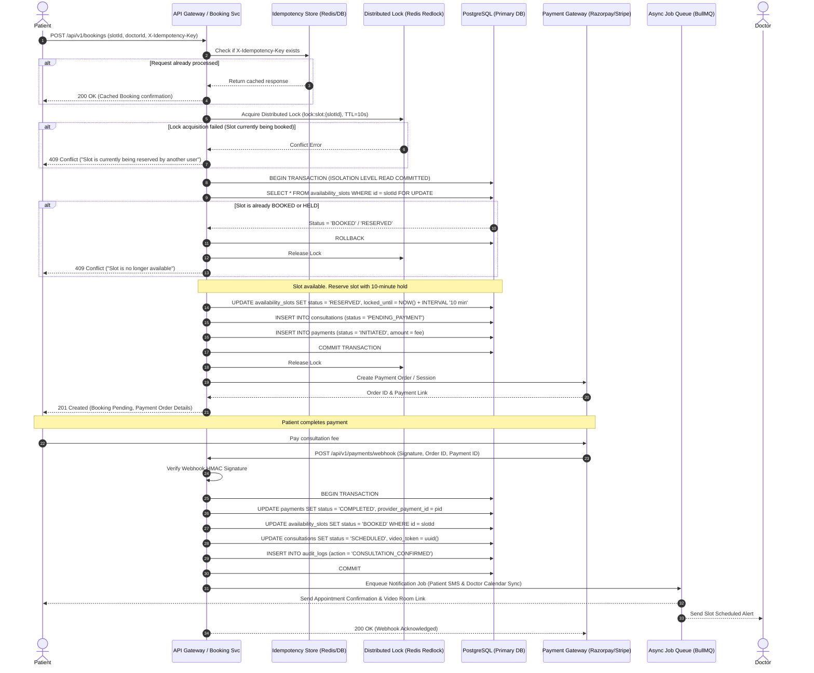
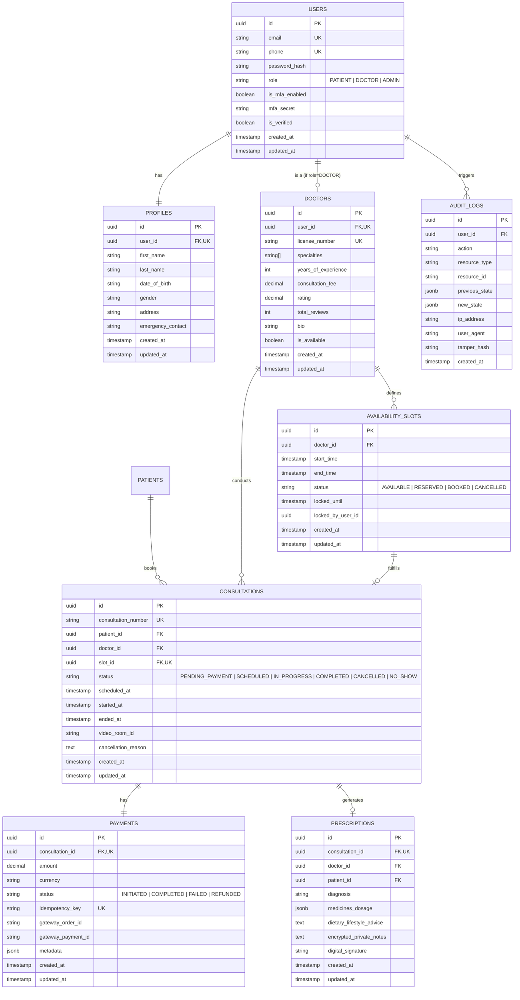
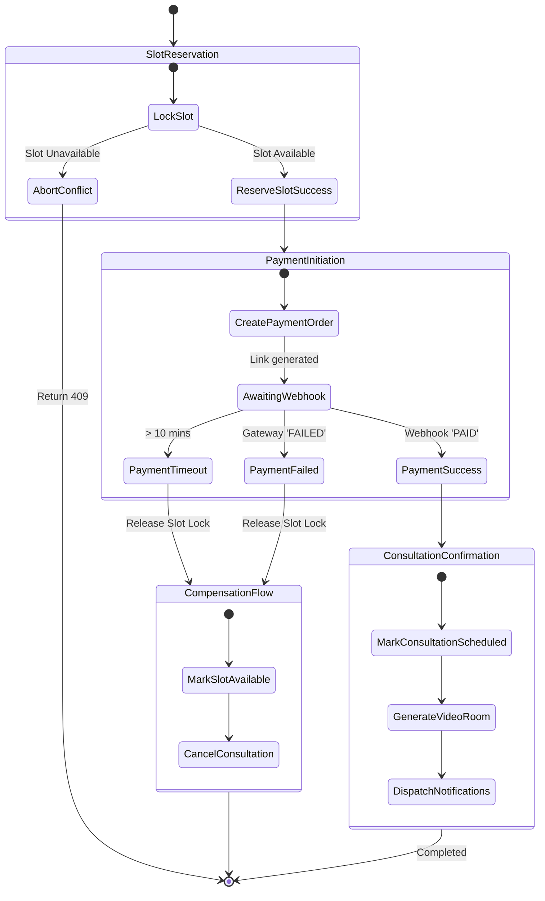

# Amrutam Telemedicine System — Architecture & System Design Document

**System Scale Target:** 100,000 daily consultations  
**Availability SLA:** 99.95% (Downtime < 4.38 hours/year)  
**Latency SLAs:** p95 < 200ms (Reads), p95 < 500ms (Writes)  
**Security & Compliance:** HIPAA-aligned Protected Health Information (PHI) encryption (AES-256), RBAC, MFA, Immutable Audit Logging  

---

## 1. High-Level Architecture & Data Flow

```mermaid
graph TB
    subgraph Client Layer
        Web[Amrutam Web App]
        Mobile[Amrutam Mobile App]
        AdminP[Admin Analytics Portal]
    end

    subgraph Edge & Security Layer
        CDN[CloudFront / Cloudflare Edge]
        WAF[AWS WAF / Rate Limiter]
        LB[Application Load Balancer / Nginx Ingress]
    end

    subgraph API Gateway & Micro-Modular Services
        GW[API Gateway / Reverse Proxy]
        AuthSvc[Auth & Identity Service (MFA/RBAC)]
        DoctorSvc[Doctor Directory & Search Engine]
        BookingSvc[Booking & Concurrency Engine]
        ConsultSvc[Consultation Lifecycle Service]
        RxSvc[Prescription & Medical Records]
        PaySvc[Payment & Ledger Service]
        AuditSvc[Immutable Audit Logging]
        MetricSvc[Observability & Health Checks]
    end

    subgraph Caching & Distributed Coordination
        RedisCluster[(Redis Cluster: L1 Cache, Distributed Locks, Rate Limiting)]
        MsgQueue[(Async Queue: BullMQ / Kafka for Webhooks & Notifications)]
    end

    subgraph Persistence Layer
        MasterDB[(Primary PostgreSQL 16 - Writes)]
        ReplicaDB[(Read Replica PostgreSQL 16 - Reads)]
        AuditStore[(Append-Only Cold Audit Log Store / S3 Glacier)]
    end

    subgraph Observability
        Prom[Prometheus Metrics Engine]
        Graf[Grafana Dashboards]
        OTel[OpenTelemetry Collector]
        PinoLog[Structured JSON Log Stream]
    end

    Web --> CDN --> WAF --> LB --> GW
    Mobile --> CDN --> WAF --> LB --> GW
    AdminP --> CDN --> WAF --> LB --> GW

    GW --> AuthSvc
    GW --> DoctorSvc
    GW --> BookingSvc
    GW --> ConsultSvc
    GW --> RxSvc
    GW --> PaySvc
    GW --> MetricSvc

    BookingSvc --> RedisCluster
    BookingSvc --> MsgQueue
    BookingSvc --> MasterDB

    DoctorSvc --> RedisCluster
    DoctorSvc --> ReplicaDB

    AuthSvc --> MasterDB
    ConsultSvc --> MasterDB
    RxSvc --> MasterDB

    AllServices -. Audit Events .-> AuditSvc --> MasterDB
    AuditSvc -. Periodic Archival .-> AuditStore

    GW -. Telemetry .-> OTel
    GW -. Metrics .-> Prom --> Graf
    GW -. Logs .-> PinoLog
```

### Data Flow Overview:
1. **Client Ingress:** Requests hit Cloudflare/WAF for TLS termination, DDoS filtering, and IP-based rate limiting before reaching the Load Balancer.
2. **API Layer:** Express/Node.js micro-modular service layer handles token validation (JWT), correlation ID injection (`X-Request-Id`), and idempotency check (`X-Idempotency-Key`).
3. **Reads Routing:** Doctor search and availability queries hit Redis L1 Cache (5-minute TTL with cache invalidation on booking), falling back to PostgreSQL Read Replicas (p95 < 50ms).
4. **Writes Routing:** Booking and Payment transactions route to the Primary PostgreSQL instance with row-level locks and Redis distributed redlocks to guarantee zero double-booking.
5. **Async Processing:** Notification dispatch (SMS, Email, Push) and prescription PDF generation run offloaded via BullMQ worker queues to keep API latency < 150ms.

---

## 2. Booking Flow Sequence Diagram

The booking workflow implements a **Pessimistic Concurrency Lock with Idempotency and Saga Pattern** to ensure absolute consistency across high concurrency bursts.



---

## 3. Entity-Relationship (ER) Diagram



---

## 4. API Schema & Endpoints

The API is standardized on REST with JSON payloads, OpenAPI 3.0 specification, strict RFC-7807 error responses, and semantic HTTP status codes.

| Resource | Method | Path | Description | Access Control |
| :--- | :---: | :--- | :--- | :--- |
| **Auth** | `POST` | `/api/v1/auth/register` | Patient/Doctor registration | Public |
| | `POST` | `/api/v1/auth/login` | User login (returns JWT or MFA challenge) | Public |
| | `POST` | `/api/v1/auth/mfa/setup` | Generate TOTP secret & QR code | Authenticated |
| | `POST` | `/api/v1/auth/mfa/verify` | Verify TOTP code & activate MFA | Authenticated |
| | `POST` | `/api/v1/auth/refresh` | Refresh expired access token | Public (Refresh Token) |
| **Doctors** | `GET` | `/api/v1/doctors` | Search doctors (filter by specialty, fee, rating, availability) | Public / All |
| | `GET` | `/api/v1/doctors/:id` | Doctor profile & available slot dates | Public / All |
| **Slots** | `POST` | `/api/v1/doctors/:id/slots` | Create availability slots (bulk recurring supported) | Doctor / Admin |
| | `GET` | `/api/v1/doctors/:id/slots` | Fetch open slots for a date range | Public / All |
| **Bookings** | `POST` | `/api/v1/bookings` | Reserve slot & initiate consultation (`X-Idempotency-Key` required) | Patient |
| | `GET` | `/api/v1/bookings/:id` | Get booking status | Patient / Doctor / Admin |
| **Consultations**| `GET` | `/api/v1/consultations` | List user consultations | Authenticated |
| | `GET` | `/api/v1/consultations/:id` | Get consultation details & video room token | Participant / Admin |
| | `PATCH`| `/api/v1/consultations/:id/status`| Update status (`IN_PROGRESS`, `COMPLETED`, `CANCELLED`) | Doctor / Admin |
| **Prescriptions**| `POST`| `/api/v1/consultations/:id/prescriptions`| Issue prescription with medicines & encrypted notes | Doctor |
| | `GET` | `/api/v1/consultations/:id/prescriptions`| View issued prescription | Patient / Doctor / Admin |
| **Payments** | `POST` | `/api/v1/payments/webhook` | Webhook receiver for payment gateway with HMAC verification | Webhook Provider |
| **Analytics** | `GET` | `/api/v1/admin/analytics/overview` | Platform KPI stats (consultation volume, revenue, doctor load) | Admin |
| **Audit** | `GET` | `/api/v1/admin/audit-logs` | Immutable audit log trail with filter | Admin / Auditor |
| **Observability**| `GET` | `/health/liveness` | Kubernetes liveness probe | Public |
| | `GET` | `/health/readiness`| Kubernetes readiness probe (checks DB, Redis) | Public |
| | `GET` | `/metrics` | Prometheus metrics endpoint | Scraper / Internal |

---

## 5. Retry & Exponential Backoff Strategies

In an ecosystem interacting with third-party payment gateways, notification SMS vendors, and video streaming servers, transient failures are inevitable.

### Strategy Formula:
$$T_{wait} = \min(M, B \times 2^{\text{attempt}}) \pm \text{jitter}$$
* $B$ (Base delay) = 500ms
* $M$ (Max delay) = 30,000ms (30 seconds)
* $\text{jitter}$ = Uniform random variance (0% to 25%) to prevent the "Thundering Herd" problem on recovered dependencies.

### Circuit Breaker Pattern:
* If failure rate exceeds **50% within a 60-second window**, the Circuit Breaker trips to **OPEN**.
* Immediate fast-failure for callers without exhausting connection pools.
* After 30 seconds, state transitions to **HALF-OPEN**; 5 test requests verify provider recovery before resetting to **CLOSED**.

```
[Service Call] --> (Circuit Closed) --> [Provider]
      |                                      |
Failures > 50%                           Success
      v                                      |
(Circuit OPEN) --- 30s Wait ---> (Circuit HALF-OPEN)
```

---

## 6. Data Partitioning & Sharding Strategy

### Capacity Estimation:
* **Consultations per day:** $100,000$
* **Consultations per year:** $100,000 \times 365 = 36,500,000$ records (~36.5M rows/year).
* **Storage growth:** Approx $2.5\text{ KB}$ per consultation row with relations $\rightarrow \approx 91.25\text{ GB/year}$ of relational data.
* **Audit Logs:** Approx $500,000\text{ actions/day} \rightarrow 182.5\text{M rows/year}$.

### Partitioning Design:
1. **Time-Based Declarative Partitioning on PostgreSQL:**
   * `consultations` and `audit_logs` are partitioned by **Range on `created_at` (Monthly partitions)**:
     ```sql
     CREATE TABLE consultations (
         id UUID NOT NULL,
         scheduled_at TIMESTAMPTZ NOT NULL,
         ...
     ) PARTITION BY RANGE (scheduled_at);

     CREATE TABLE consultations_2026_10 PARTITION OF consultations
         FOR VALUES FROM ('2026-10-01 00:00:00+00') TO ('2026-11-01 00:00:00+00');
     ```
2. **Partition Pruning:** Queries targeting recent consultations only scan the active partition table, preserving index tree depth (B-Tree) to $O(\log N_{month})$ instead of $O(\log N_{total})$.
3. **Hot/Cold Tiering:**
   * Active month data remains on High-IOPS NVMe EBS volumes.
   * Partitions older than 12 months are compressed with `pg_dump` or Parquet and offloaded to Amazon S3 Glacier for long-term legal medical retention (7+ years) while truncating cold partitions from active PostgreSQL storage.

---

## 7. Caching & Concurrency Handling (Zero Double-Booking)

### Read Caching Architecture:
* **Doctor Profile & Availability Cache:**
  * Key: `cache:doctor:{id}` (TTL: 1 hour, invalidated on profile update).
  * Key: `cache:slots:doctor:{id}:date:{YYYY-MM-DD}` (TTL: 5 minutes, invalidated immediately upon slot reservation).
* **Cache Stampede Prevention:** Mutex/SingleFlight pattern so that only one worker repopulates an expired cache key while others wait or serve stale data.

### Two-Tier Concurrency Lock:
1. **Tier 1 (Redis Redlock - Fast Rejection):**
   * Before hitting PostgreSQL, acquire a distributed key: `lock:slot:{slot_id}` with a 10-second TTL.
   * If Redis returns `0`, immediately abort with `409 Conflict` (p95 < 5ms).
2. **Tier 2 (PostgreSQL `SELECT ... FOR UPDATE` - Absolute Consistency):**
   * Inside the ACID transaction, perform a pessimistic row-level lock:
     ```sql
     SELECT id, status, locked_until 
     FROM availability_slots 
     WHERE id = $1 
     FOR UPDATE;
     ```
   * Ensures serializeable safety even if Redis cache is flushed or restarts.
   * Slot status transitions from `AVAILABLE` $\rightarrow$ `RESERVED` (held for 10 minutes) $\rightarrow$ `BOOKED` upon payment success. If payment expires, a periodic reconciler unlocks the slot back to `AVAILABLE`.

---

## 8. Transaction Management & Saga Pattern

A telemedicine booking crosses multiple boundaries: slot reservation, consultation state machine, payment processing, and notification dispatch. A single distributed 2-Phase-Commit (2PC) locks tables too long and harms availability. Hence, we use an **Orchestrated Saga Pattern**.



### Compensating Transactions:
* If Payment fails or times out (10 minutes elapsed without successful webhook):
  * Revert slot status back to `AVAILABLE`.
  * Update consultation state to `CANCELLED`.
  * Emit audit log for timeout.

---

## 9. Backup & Disaster Recovery (DR) Strategy

### SLA Targets:
* **RPO (Recovery Point Objective):** $< 5 \text{ minutes}$ (Maximum tolerable data loss)
* **RTO (Recovery Time Objective):** $< 15 \text{ minutes}$ (Maximum tolerable downtime)

### Replication & DR Architecture:
1. **Multi-AZ Primary-Standby Replication:**
   * PostgreSQL AWS RDS Multi-AZ deployment with synchronous streaming replication to an automated hot-standby in another Availability Zone.
   * Automatic failover triggers in $< 60$ seconds with zero data loss.
2. **Point-In-Time Recovery (PITR):**
   * Continuous Write-Ahead Log (WAL) archiving to S3 every 5 minutes.
   * Daily full automated snapshot at 02:00 AM UTC with 35-day retention.
3. **Cross-Region Cold DR Site:**
   * S3 bucket replication of database snapshots and encrypted audit archives to a secondary geographic region (e.g., primary `ap-south-1` Mumbai $\rightarrow$ secondary `ap-southeast-1` Singapore).
   * Terraform scripts pre-configured for automated spinning of ECS/EKS clusters in the secondary region in the event of an entire cloud region blackout.
4. **Automated DR Drills:**
   * Bi-monthly chaos engineering tests to simulate master database failure and verify automatic failover and data integrity.
